<!-- voidinjector.pcapng — a packet-capture of Nishen Madava. All visuals are hand-made SVGs in ./assets -->

<a href="https://voidinjector-portfolio.netlify.app/"></a>

<table>
  <tr>
    <td width="200" align="center" valign="top">
      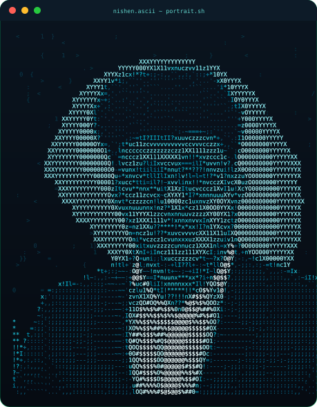
    </td>
    <td valign="top">
      
    </td>
  </tr>
</table>

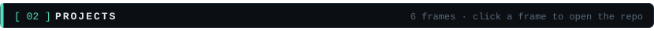

<table>
  <tr>
    <td width="50%" valign="top"><a href="https://github.com/nishenmadawa15-collab/SOCWatch">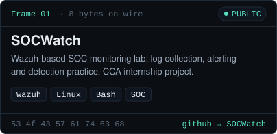</a></td>
    <td width="50%" valign="top">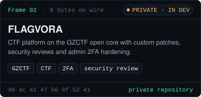</td>
  </tr>
  <tr>
    <td width="50%" valign="top"><a href="https://github.com/nishenmadawa15-collab/nexskill">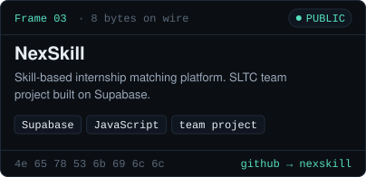</a></td>
    <td width="50%" valign="top"><a href="https://github.com/nishenmadawa15-collab/eliya">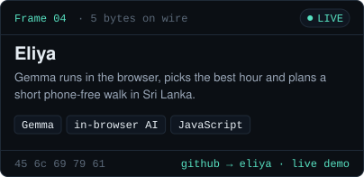</a></td>
  </tr>
  <tr>
    <td width="50%" valign="top"><a href="https://github.com/nishenmadawa15-collab/voidinjector-portfolio">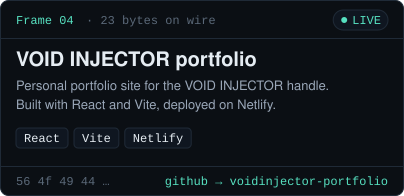</a></td>
    <td width="50%" valign="top"><a href="https://github.com/nishenmadawa15-collab/bg-remover">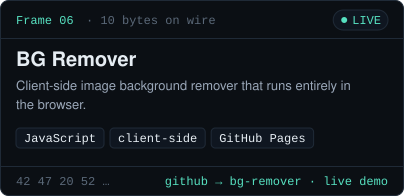</a></td>
  </tr>
</table>

  live demos &nbsp;·&nbsp; <a href="https://nishenmadawa15-collab.github.io/eliya/">Eliya</a> &nbsp;·&nbsp; <a href="https://voidinjector-portfolio.netlify.app/">VOID INJECTOR portfolio</a> &nbsp;·&nbsp; <a href="https://nishenmadawa15-collab.github.io/bg-remover/">BG Remover</a>

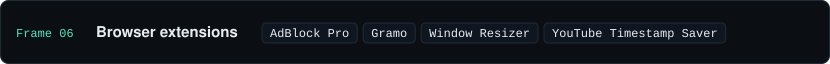

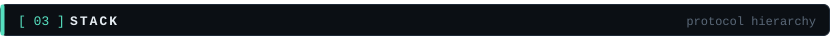

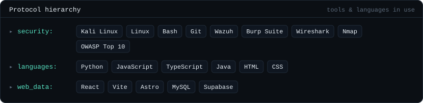

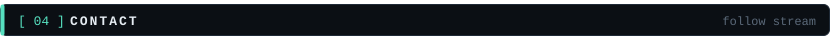

  <a href="https://www.linkedin.com/in/nishen-madava">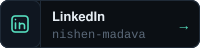</a>
  <a href="https://voidinjector-portfolio.netlify.app/">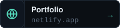</a>
  <a href="mailto:nishenmadawa15@gmail.com">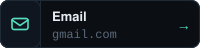</a>
  <a href="https://github.com/nishenmadawa15-collab?tab=repositories">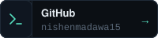</a>

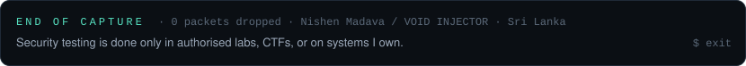
